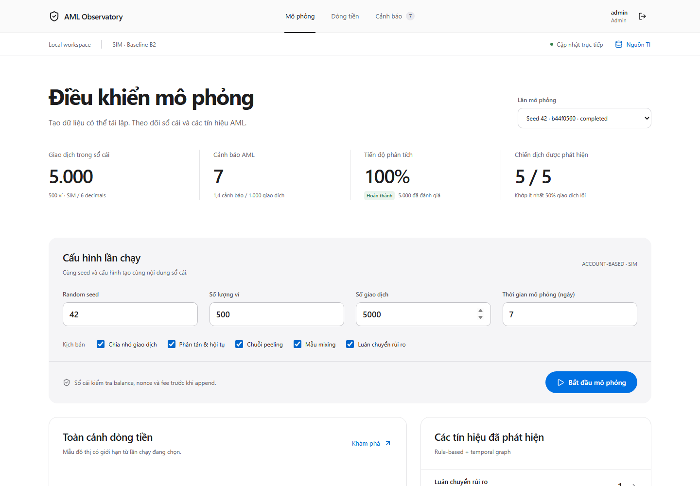
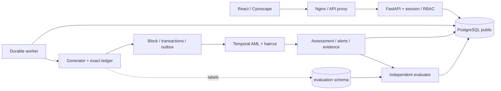

# AML Observatory — mô phỏng AML trong giao dịch blockchain

Khung local chạy thực với **FastAPI + PostgreSQL + worker + React/Cytoscape**,
theo [kế hoạch](Ke-hoach-AML-Blockchain.md). Account-based, một tài sản giả lập
SIM (6 decimals), baseline B2: rule-based + temporal graph + haircut allocation.



Giao diện dùng nền trung tính, điều hướng ngang và phân cấp chữ lấy cảm hứng từ
[Apple](https://www.apple.com/). [Kiểm chứng UI và ảnh các màn hình](docs/reports/ui-validation.md).

## Chạy local

Cần Docker Desktop đang chạy Linux containers và Node.js 24. Không cần cài
Python hoặc PostgreSQL trên Windows. Chạy trong thư mục repository:

```powershell
node scripts/setup.mjs
docker compose up --build -d --wait
```

Hoặc `node scripts/local.mjs up`. Lần đầu tải image và cài dependency theo lockfile.
Migration tự chạy một lần trước API/worker; dữ liệu giữ trong named volume.

| Thành phần | Địa chỉ |
| --- | --- |
| Dashboard | http://localhost:8080 |
| Swagger/OpenAPI | http://localhost:8000/api/docs |
| Health | http://localhost:8080/api/health |
| PostgreSQL (tùy chọn kết nối trực tiếp) | 127.0.0.1:5433, database `aml` |

Tài khoản `admin`, `analyst`, `viewer`. Mật khẩu tương ứng nằm ở `ADMIN_PASSWORD`,
`ANALYST_PASSWORD`, `VIEWER_PASSWORD` trong **file `.env` local được sinh ngẫu nhiên**.
Không có mật khẩu mặc định trong source. `.env` không được commit.
Admin tạo/replay/sửa feed; Analyst/Admin review; Viewer chỉ đọc. Đây là workspace
local chung, chưa phải hệ thống đa tenant. DB theo kế hoạch là PostgreSQL;
không sử dụng hoặc thay đổi MySQL có sẵn trên máy.

## Luồng demo

1. Đăng nhập admin, giữ seed=42 / 500 ví / 5.000 tx / 7 ngày, bật các kịch bản,
   chọn **Bắt đầu mô phỏng**. Đây là simulated time, không đợi 7 ngày ngoài đời.
2. Worker tạo ledger hợp lệ, ghi block/outbox và phân tích theo thứ tự; UI nhận
   SSE và có HTTP polling khi reconnect.
3. Mở **Cảnh báo & đánh giá**, chọn **Xem bằng chứng**: graph và bảng giao dịch
   chỉ rõ đường đi, lượng tiền, observed values, thresholds và score components/floors.
4. Đổi trạng thái review kèm ghi chú. History được lưu riêng, không sửa quyết định engine.
5. Dùng as-of slider để cắt dữ liệu theo global order; filter trung tâm/hops để
   giới hạn đồ thị. Dữ liệu bị cắt hoặc thiếu provenance được đánh dấu partial.
6. Replay tạo analysis version mới trên ledger cũ. Feed mới chỉ áp dụng qua
   snapshot mới; replay hồi cứu khác as-known và giữ kết quả cũ.

Các rule: STRUCTURING, SMURFING, PEELING, MIXING_PATTERN, RAPID_HIGH_RISK,
DIRECT_BLACKLIST. Score floors 70/80/95; làm tròn half-up, baseline A=0.
Score thể hiện **ưu tiên xem xét**, không phải xác suất hoặc kết luận pháp lý.

## Kiểm tra và thao tác

```powershell
docker compose ps
docker compose logs --tail 100 api worker
docker compose --profile test run --rm test
node scripts/smoke.mjs --count=5000 --restart-worker
```

Test integration chỉ reset database **`aml_test`**; không reset `aml`.
Smoke tạo run tổng hợp trong `aml`, kiểm RBAC/CSRF/idempotency/cursor/timeline/
budget/review/SSE/replay và có thể restart worker giữa ingestion. Báo cáo local
ở `artifacts/smoke-report.json` (ignored). Để đo workload lớn hơn:
`node scripts/smoke.mjs --count=100000`; không coi tùy chọn này là benchmark đã đạt.

Frontend development/QA:

```powershell
cd frontend
npm.cmd ci
npm.cmd run dev
npm.cmd test
npm.cmd run build
npx.cmd playwright install chromium
npm.cmd run test:e2e
```

Dev server in proxy API qua localhost:8000. E2E cần stack và một run completed;
Playwright dùng Chromium theo phiên bản lockfile, tách khỏi browser profile cá nhân.
Các lệnh `.cmd` trên tránh lỗi execution policy của PowerShell; trên Linux dùng `npm`/`npx`.
Trace tắt để không lưu login payload. Ảnh QA ở `artifacts/`, không commit credential.

Dừng: `docker compose down` (giữ volume). Khởi động lại: `docker compose up -d --wait`.
Không dùng `down -v` để xử lý lỗi. Không xóa `.env` khi volume còn dữ liệu;
regenerate password sẽ không đổi mật khẩu role/user đã được bootstrap trong DB.
Chạy nhiều bản checkout cùng máy cần project name/port riêng; đừng chia sẻ volume
với credential mới. Schema thay đổi bằng migration mới, không sửa migration đã dùng chung.

## Kiến trúc và dữ liệu



Python `int` / DB `NUMERIC(78,0)` / JSON money strings / frontend BigInt.
UTC và order `(block_height,tx_index)`; API `global_index` là chỉ số liên tiếp
tương đương trong run, không thay thứ tự consensus. Hash simulator SHA256
canonical; supply gồm fee_sink bảo toàn. Không giả EVM/signature/PoW/PoS.

`aml_owner` chỉ bootstrap/migration; `aml_app` không được đọc evaluation schema;
`aml_evaluator` đọc nhãn để đánh giá. API không có evaluator DSN. AML engine pure
chỉ nhận genesis, ledger, feed snapshot; không import generator labels/evaluator.
Worker có advisory lock, checkpoint sau durable commit; restart dựng lại state
từ genesis/ledger rồi tiếp tục. Rejected intents không tạo cạnh AML.

Đọc [data contracts](docs/contracts/local-api.md),
[quyết định kiến trúc](docs/decisions/0001-local-architecture.md),
[bộ quy tắc](.codex/README.md) và [báo cáo kiểm chứng](docs/reports/local-validation.md).

## Phạm vi hiện tại

Baseline B2 hoạt động local. Provenance giữ tối đa 5 hop và compact khi một ví
vượt 128 phần vốn; số dư vẫn bảo toàn, các phần mất đường giải thích được partial.
Candidate mixing là heuristic vùng trung gian, không xác nhận một dịch vụ mixer.
Payroll/custody giống hình thái có thể cảnh báo; không dùng truth để bỏ qua.

Metrics demo là **single-run synthetic evaluation**, tách online/retrospective.
Chưa công bố chất lượng unseen runs, split nghiên cứu 60/20/20 / >=5 seed,
AP/bootstrap CI, full B0–B3 ablation hoặc mục tiêu D-standard/D-stress đã đạt.
Isolation Forest, UTXO, EVM adapter, reorg, token/bridge/GNN là bước mở rộng;
không có nhãn “đã hỗ trợ” khi chưa implement. Các service chỉ bind loopback;
triển khai public cần auth/TLS/secret/backup/retention review riêng.

Background hiện tại là P2P theo seed; bộ merchant/payroll/treasury có tham số,
nhiều campaign/seed và backward investigation API đầy đủ là phần phát triển
tiếp theo của nghiên cứu. Graph neighborhood cung cấp ngữ cảnh; chỉ evidence
AML mới thể hiện đường phân bổ nhân quả. TI hồi cứu có metrics sequential riêng,
không được báo thành chất lượng online as-known.
