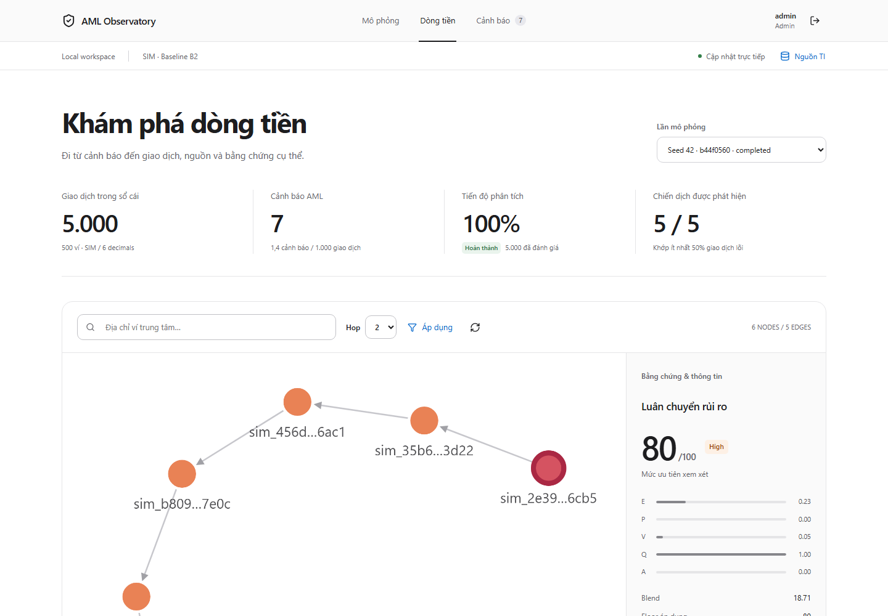
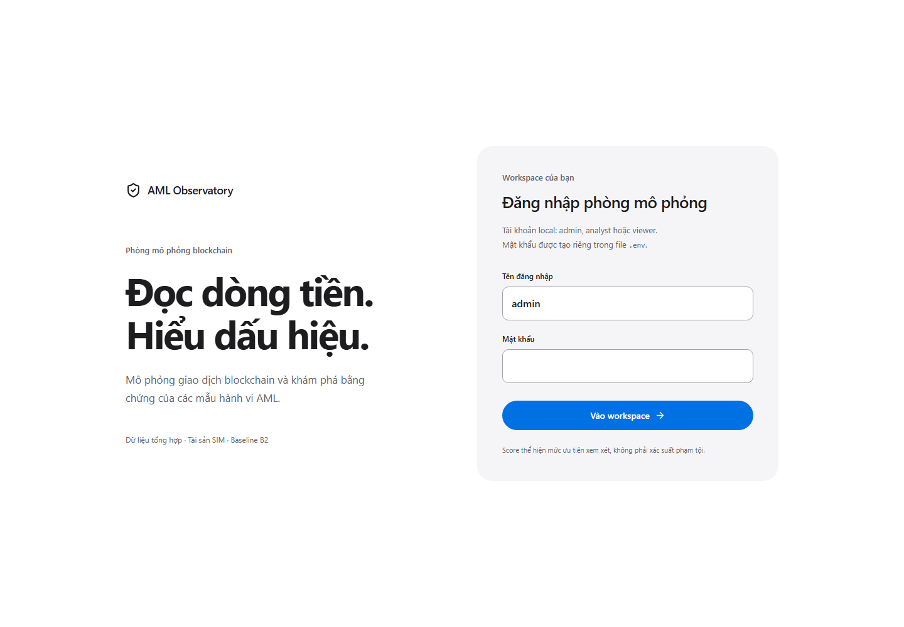
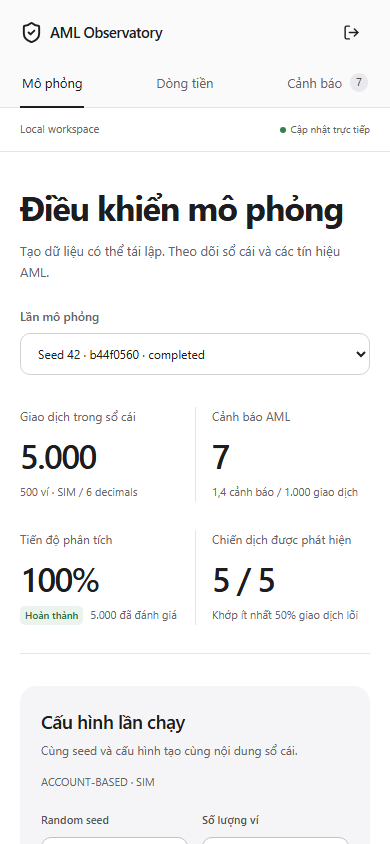

# Kiểm chứng giao diện — 15/10/2026

Yêu cầu: giao diện tiết chế, tham khảo [Apple](https://www.apple.com/), giữ nguyên
spec AML và commit/push GitHub. Thiết kế mới dùng system font, nền trắng/xám,
điều hướng ngang, số liệu phân cách bằng đường mảnh và xanh cho thao tác. Giữ
branding AML Observatory và màu severity; không dùng tài sản thương hiệu Apple.

## Phạm vi và kiểm tra

Diff ứng dụng chỉ gồm `App.tsx`, `Graph.tsx`, `style.css`. React thay markup,
nhãn presentation và accessibility; Cytoscape đổi font/màu selection/cạnh.
Backend, API client/types, money formatter, migrations, database và lockfiles
không thay đổi. Các handlers, min/max input, API endpoints, Graph data/layout,
RBAC, SSE, run/as-of, score/coverage/partial và phân biệt online/hồi cứu giữ nguyên.

| Kiểm tra | Kết quả |
| --- | --- |
| Docker build frontend: TypeScript + Vite | Passed; web recreate riêng và healthy qua API proxy |
| `npm.cmd test` | 4 unit tests passed, gồm tiền BigInt chính xác |
| `npm.cmd run test:e2e` | 2 browser tests passed trên stack local thật |
| Prettier check bốn file frontend thay đổi | Passed |
| Desktop 1440×1000 | Login, điều khiển, alerts, evidence graph và review đã kiểm tra ảnh |
| 390 / 768 / 1024 / 1440 px | Ba view truy cập được, active navigation đúng, không tràn ngang toàn trang |
| Viewer | Không có nút quản lý TI/replay/review; nút tạo run bị vô hiệu hóa |
| Timeline / evidence / review | Graph thực có nodes/edges, lưu review mới, keyboard Home/ArrowRight đổi cutoff |

Test dùng run 5.000 giao dịch đang có, không reset dữ liệu. Nhận xét E2E có ID
riêng để chạy lặp không trùng locator với review cũ. Chờ graph có nodes tối đa
30 giây thay vì giả định dữ liệu đến trong 5 giây; giữ assertion positive count
và canvas thật. Trace tắt; ảnh login chụp trước khi nhập mật khẩu.

Không chạy lại benchmark AML 5.000/100k vì pipeline không đổi. Số đo nghiệp vụ
baseline nằm ở [báo cáo local](local-validation.md). Full CI vẫn chạy backend,
PostgreSQL, API smoke và browser workflow sau push; trạng thái cuối được kiểm tra
trên GitHub Actions, không suy ra từ unit tests frontend.

## Ảnh giao diện thật

